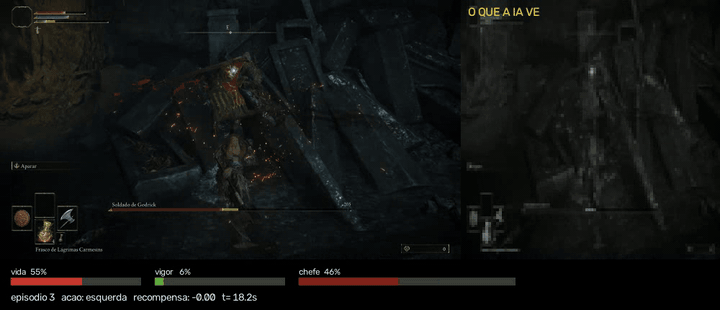

# elden-rl

Agente de **aprendizado por reforço** que aprende a lutar contra um chefe do **Elden Ring**
usando apenas a imagem da tela e teclas simuladas, em tempo real, sem acesso à memória ou ao
código do jogo.



*À esquerda, o jogo; à direita, a imagem que o agente recebe; embaixo, os valores lidos da tela.*

## Por que este projeto

Projetos de RL em jogos costumam usar emuladores de consoles antigos, que permitem ler a
memória do jogo (posição, vida, pontuação). O Elden Ring não oferece nenhuma interface desse
tipo. Aqui o agente joga como um humano: **vê a tela e aperta teclas**. Isso exige construir
todo o ambiente de treino do zero, que é a principal contribuição do projeto.

## Como funciona

```
 tela do jogo ──► captura (mss) ──┬──► leitura do HUD (OpenCV) ──► vida, vigor, vida do chefe ──┐
                                  │                                                             │
                                  └──► 4 quadros 96×96 em cinza ────────────────────────────────┤
                                                                                                ▼
 teclado simulado ◄── ação (1 de 13) ◄── política PPO (CNN + MLP) ◄── observação + recompensa
 (SendInput)
```

| Componente | Técnica | Arquivo |
|---|---|---|
| Captura da janela | `mss` + `win32gui` | `elden_rl/window.py` |
| Leitura das barras | Visão computacional clássica: segmentação por cor em HSV, posições em proporção da tela | `elden_rl/hud.py` |
| Detecção de eventos | Morte, início da luta e vitória por duração mínima dos sinais | `elden_rl/events.py` |
| Controle | `SendInput` do Windows com *scan codes* (teclado e mouse) | `elden_rl/winput.py`, `controls.py` |
| Reset automático | Máquina de estados: renasce, atravessa a névoa, anda até o meio da arena e trava a mira | `elden_rl/reset.py` |
| Ambiente | Gymnasium: observação = imagem + barras + última ação; 13 ações a cada 0,2 s | `elden_rl/env.py` |
| Agente | PPO (Stable-Baselines3 + PyTorch em GPU), `MultiInputPolicy` treinada do zero | `scripts/06_train.py` |
| Registro | Vídeo lado a lado + uma linha por luta em `episodes.csv` | `elden_rl/recorder.py` |

**Recompensa por passo:** +10 × fração da vida do chefe retirada, −5 × fração da própria vida
perdida, +1 × cura, −0,002 por passo; +20 na vitória e −5 na morte.

## Resultados até agora

Chefe: Soldado de Godrick (tutorial). Personagem de nível 1.

| Rodada | Mira travada no início | Lutas | Dano médio no chefe | Lutas sem nenhum golpe | Vitórias |
|---|---|---|---|---|---|
| treino01 | não | 36 | 10,6% | 22 | 0 |
| treino02 | sim | 2 | 84,4% | 0 | 1 (na 2ª luta) |

A análise da primeira rodada mostrou que, em 61% das lutas, o agente não acertava nenhum
golpe: ele começava longe do chefe e sem a mira travada. Ajustar o roteiro de reset para
avançar até o centro da arena e travar a mira elevou o dano médio de 10,6% para 84,4%.

**Limitações e interpretação:** a vitória aconteceu com apenas ~390 decisões de treino, o
que é muito pouco para RL. Ela se deve principalmente à engenharia do ambiente e à
fragilidade de um chefe de tutorial, não a um comportamento aprendido. Com duas lutas na
segunda rodada, os números servem como observação, não como resultado estatístico.

## Próximos passos

- Registrar cada decisão (`steps.csv`) e analisar o comportamento do agente por fase da luta.
- Linhas de base: agente aleatório e robô de regras fixas.
- Restauração automática do save após cada vitória, para treinar por centenas de lutas e
  medir a **taxa de vitória** ao longo do treino.
- Chefes mais difíceis, como Margit.

## Regras de segurança

- **Jogue sempre offline** (Sistema > Rede > Iniciar no modo offline). Ferramentas externas
  com o jogo online podem levar a banimento.
- Use um **personagem dedicado ao projeto**.
- Faça **backup do save** com o jogo fechado (`python scripts/backup_save.py`). O save fica em
  `%APPDATA%\EldenRing\<número da Steam>\ER0000.sl2` e guarda todos os personagens.
  Um chefe derrotado não volta: restaure o backup (`python scripts/restore_save.py`).
- O repositório nunca guarda saves, modelos ou vídeos (ver `.gitignore`).

## Configuração do jogo

- Modo **janela**, **1280×720** (qualquer resolução 16:9 funciona), no monitor principal.
- Exibição: **HUD = "Ligado"** (no modo "Automático" as barras somem fora de combate).
- Opções de jogo: "Alternar trava automática" e "Seleção automática de alvo" ligados.
- Teclas no padrão do jogo; ajuste `keys.json` se as suas forem diferentes. A trava de mira
  padrão é o clique da rodinha do mouse (`mouse_middle`).

## Instalação (Windows, PowerShell)

O projeto roda no Windows (não no WSL), porque precisa enxergar e controlar a janela do jogo.

```powershell
git clone https://github.com/FernandoPCJ/elden-rl.git
cd elden-rl
python -m venv .venv          # Python 3.11 a 3.13
.venv\Scripts\Activate.ps1
pip install -r requirements.txt
python -m unittest discover -s tests
```

Instale o PyTorch com suporte à GPU pelo comando indicado em
<https://pytorch.org/get-started/locally/> e confira:

```powershell
python -c "import torch; print(torch.__version__, torch.cuda.is_available())"
```

**Importante:** o jogo roda como administrador, e o Windows bloqueia teclas simuladas vindas
de programas sem esse privilégio (UIPI). Abra o PowerShell **como administrador**.
O `scripts/00_input_diag.py` verifica isso.

## Uso

Com o jogo aberto, em janela, e o personagem na Estaca de Marika diante do chefe:

```powershell
python scripts/01_capture_test.py --calibrate         # calibra as barras (vida e vigor cheios)
python scripts/03_reset_test.py                        # testa o caminho até a luta
python scripts/06_train.py --run treino01 --hours 8    # treina (Ctrl+C salva e para)
python scripts/07_analyze.py --run treino01            # gráficos de dano, duração e retorno
python scripts/08_export_video.py runs/treino01/videos/VIDEO.mp4   # vídeo para publicar
```

| Script | Para quê |
|---|---|
| `00_input_diag.py` | Diagnóstico de permissões e envio de teclas |
| `01_capture_test.py` | Captura, calibração do HUD e leitura em tempo real |
| `02_input_test.py` | Confere se o jogo obedece às teclas |
| `03_reset_test.py` | Roteiro de reset até o início da luta |
| `04_record_test.py` | Teste da gravação |
| `05_random_agent.py` | Agente aleatório (valida o ambiente, sem PyTorch) |
| `06_train.py` | Treino PPO com checkpoints e `--resume` |
| `07_analyze.py` | Análise do `episodes.csv` |
| `08_export_video.py` | Converte o vídeo para H.264 (LinkedIn, YouTube) |
| `backup_save.py`, `restore_save.py` | Backup e restauração do save |

## Referências

- [Stable-Baselines3](https://github.com/DLR-RM/stable-baselines3) e [Gymnasium](https://gymnasium.farama.org/)
- Schulman et al. (2017), *Proximal Policy Optimization Algorithms*
- Mnih et al. (2015), *Human-level control through deep reinforcement learning* (CNN para Atari)
- [EldenRL](https://github.com/CyberDatta/EldenRL_mysystem) e [SoulsGym](https://pypi.org/project/soulsgym), abordagens anteriores em jogos da FromSoftware

## Licença

MIT. Elden Ring é marca da FromSoftware/Bandai Namco; este projeto não é afiliado a elas e não
distribui nenhum arquivo do jogo.
